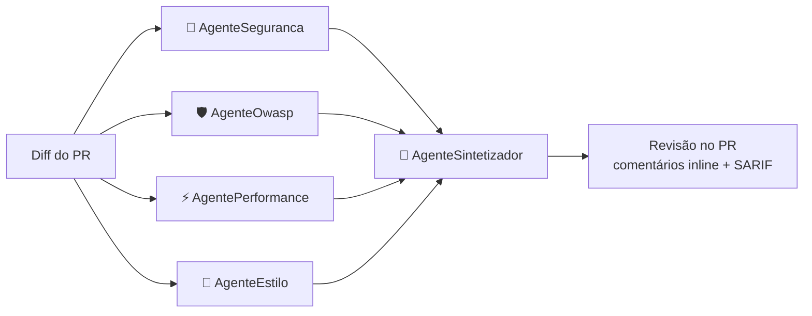

# Code Review Crew

[](https://github.com/Cosmess/code-review-crew/actions/workflows/ci.yml)


Um **revisor de código multi-agentes** construído com .NET 10 e o
[Microsoft Agent Framework](https://github.com/microsoft/agent-framework).
Agentes de IA especialistas analisam o diff de um pull request em paralelo, e um agente líder consolida
as análises em uma única revisão, publicada no PR com **comentários na linha exata** de cada problema.

## Como funciona



| Agente | Responsabilidade |
|---|---|
| **AgenteSeguranca** | Injeção, segredos no código, falhas de autenticação, exposição de dados sensíveis |
| **AgenteOwasp** | Audita o diff contra cada categoria do OWASP Top 10:2025 (A01–A10) e marca cada problema com a categoria |
| **AgentePerformance** | Consultas N+1, sync-over-async, alocações desnecessárias, falta de CancellationToken |
| **AgenteEstilo** | Nomenclatura, exceções engolidas, código morto, manutenibilidade |
| **AgenteSintetizador** | Une duplicatas, descarta falsos positivos, ordena por severidade e decide o veredito |

## Destaques

- **Orquestração fan-out / fan-in**: os especialistas rodam em paralelo; o sintetizador roda quando todos terminam.
- **Integração com GitHub**: revisa um PR pelo número e publica a revisão com comentários inline.
- **GitHub Action pronta**: `uses: Cosmess/code-review-crew@main` em qualquer repositório.
- **SARIF**: os problemas aparecem na aba *Security* do GitHub, com uma regra por categoria OWASP.
- **Resiliente**: timeout e retry com backoff em cada chamada; se um agente falhar, a revisão segue e avisa.
- **Controle de custo**: tokens e custo estimado por revisão, diffs grandes divididos em partes, e o
  sintetizador não é chamado quando não há nada para consolidar.
- **Configurável por repositório** via `.crc.yml`: agentes, severidade mínima, caminhos ignorados, limites.
- **Saída estruturada**: cada agente retorna JSON tipado (`ReviewFinding`, `ReviewReport`) em vez de texto livre.
- **OpenAI por padrão, independente de provedor**: construído sobre `IChatClient`, também roda com Ollama ou Anthropic Claude.
- **Revisões em português**, com testes unitários determinísticos e testes de integração com o modelo real.

## Usando no seu repositório (GitHub Action)

Crie o secret `OPENAI_API_KEY` e o arquivo `.github/workflows/code-review.yml`:

```yaml
name: Code Review Crew

on:
  pull_request:
    types: [opened, synchronize, reopened, ready_for_review]

permissions:
  contents: read
  pull-requests: write

jobs:
  review:
    runs-on: ubuntu-latest
    steps:
      - uses: actions/checkout@v4
      - uses: Cosmess/code-review-crew@main
        with:
          openai-api-key: ${{ secrets.OPENAI_API_KEY }}
```

Todos os inputs, envio de SARIF e bloqueio de merge com `fail-on` estão no [guia da GitHub Action](docs/guias/github-action.md).

## Usando pela linha de comando

Requisitos: [.NET 10 SDK](https://dotnet.microsoft.com/download) e uma [chave da API da OpenAI](https://platform.openai.com/api-keys).

```bash
git clone https://github.com/Cosmess/code-review-crew.git
cd code-review-crew
export OPENAI_API_KEY=sk-...

# Revisar um arquivo de diff
dotnet run --project src/CodeReviewCrew.Cli -- samples/vulnerable.diff

# Revisar as mudanças locais
git diff main | dotnet run --project src/CodeReviewCrew.Cli

# Revisar um PR do GitHub e publicar a revisão (precisa de GITHUB_TOKEN)
dotnet run --project src/CodeReviewCrew.Cli -- --pr 42 --repo dono/repositorio --post

# Exportar SARIF e falhar se houver problema High ou Critical
dotnet run --project src/CodeReviewCrew.Cli -- samples/vulnerable.diff --sarif revisao.sarif --fail-on High
```

| Opção | Descrição |
|---|---|
| `<diff>` | Arquivo de diff. Sem ele e sem `--pr`, lê da entrada padrão |
| `--pr <número>` | Revisa um pull request do GitHub |
| `--repo <dono/nome>` | Repositório do PR (padrão: `GITHUB_REPOSITORY`) |
| `--post` | Publica a revisão no PR, com comentários inline |
| `--config <arquivo>` | Configuração (padrão: `.crc.yml`, se existir) |
| `--output <arquivo>` | Salva a revisão em Markdown |
| `--sarif <arquivo>` | Salva os problemas em SARIF 2.1.0 |
| `--fail-on <severidade>` | Código de saída 2 se houver problema dessa severidade ou maior |

### Variáveis de ambiente

| Variável | Padrão | Descrição |
|---|---|---|
| `OPENAI_API_KEY` | | Chave da API da OpenAI (obrigatória no provedor padrão) |
| `CRC_PROVIDER` | `openai` | `openai`, `ollama` ou `anthropic` |
| `CRC_MODEL` | `gpt-5-mini` (OpenAI) | Id do modelo (ex.: `gpt-5-mini`, `qwen3:8b`, `claude-sonnet-5-5`) |
| `GITHUB_TOKEN` | | Necessário para `--post` e para PRs de repositórios privados |
| `OLLAMA_ENDPOINT` | `http://localhost:11434` | URL do servidor Ollama |
| `ANTHROPIC_API_KEY` | | Chave da Anthropic, quando `CRC_PROVIDER=anthropic` |

## Configuração por repositório (`.crc.yml`)

```yaml
agents: [seguranca, owasp, performance, estilo]
minSeverity: Low
ignore: ["**/*.Designer.cs", "**/Migrations/**"]
maxChunkChars: 60000
agentTimeoutSeconds: 180
maxRetries: 2
pricing:            # US$ por 1 milhão de tokens, para estimar o custo
  inputPerMillion: 0.25
  outputPerMillion: 2.00
```

Todas as opções estão comentadas em [`.crc.example.yml`](.crc.example.yml).

## Estrutura do projeto

```
src/
  CodeReviewCrew.Core/       agentes, orquestração, diff, GitHub, configuração e saídas (Markdown, SARIF)
  CodeReviewCrew.Cli/        linha de comando e escolha do provedor de LLM
tests/
  CodeReviewCrew.Tests/              testes unitários, sem rede
  CodeReviewCrew.IntegrationTests/   testes com a API real da OpenAI
docs/                        arquitetura, padrões, guias e ADRs
action.yml                   GitHub Action
AGENTS.md                    regras para agentes de IA que trabalham no repositório
```

A [documentação](docs/README.md) detalha a arquitetura, o tratamento de falhas e as decisões de design.

## Rodando os testes

```bash
dotnet test                                    # unitários; integração é ignorada sem chave
OPENAI_API_KEY=sk-... dotnet test              # inclui os testes com o modelo real
```

## Roadmap

- [x] Integração com GitHub: revisar um PR pelo número e publicar a revisão
- [x] Comentários inline na linha de cada problema
- [x] GitHub Action para rodar em todo pull request
- [x] Resiliência: timeout, retry com backoff e fallback quando um agente falha
- [x] Controle de custo: tokens, custo estimado e divisão de diffs grandes
- [x] Configuração por repositório (`.crc.yml`)
- [x] Saída em SARIF para o GitHub code scanning
- [x] Testes de integração com o modelo real
- [ ] Demo visual (GIF da revisão em um PR)
- [ ] AppHost do .NET Aspire com traces OpenTelemetry de cada agente
- [ ] Ferramentas MCP para os agentes lerem arquivos completos e convenções do repositório
- [ ] Suíte de avaliação medindo precisão/recall em diffs rotulados

## Licença

[MIT](LICENSE)
