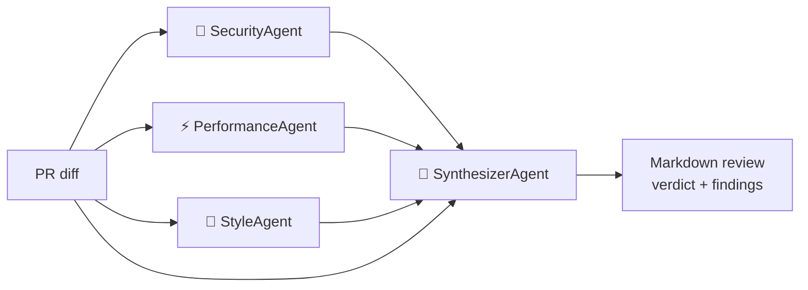

# Code Review Crew

[](https://github.com/Cosmess/code-review-crew/actions/workflows/ci.yml)


A **multi-agent code reviewer** built with .NET 10 and the
[Microsoft Agent Framework](https://github.com/microsoft/agent-framework).
Specialist AI agents review a pull request diff in parallel, and a lead agent consolidates
their findings into a single, deduplicated review, ready to post as a PR comment.

## How it works



| Agent | Responsibility |
|---|---|
| **SecurityAgent** | Injection, hardcoded secrets, auth flaws, sensitive data exposure |
| **PerformanceAgent** | N+1 queries, sync-over-async, allocations, missing cancellation |
| **StyleAgent** | Naming, swallowed exceptions, dead code, maintainability |
| **SynthesizerAgent** | Merges duplicates, discards false positives, ranks by severity, decides the verdict |

Design highlights:

- **Fan-out / fan-in orchestration**: specialists run concurrently; the synthesizer runs once all are done.
- **Structured output**: every agent returns typed JSON (`ReviewFinding`, `ReviewReport`) instead of free text.
- **Provider-agnostic**: built on `Microsoft.Extensions.AI.IChatClient`, so it runs on Ollama (local, free), OpenAI or Anthropic Claude.
- **Deterministic tests**: the orchestration is tested with a fake `IChatClient`, without calling any LLM.

## Getting started

Requirements: [.NET 10 SDK](https://dotnet.microsoft.com/download) and one LLM provider.

```bash
git clone https://github.com/Cosmess/code-review-crew.git
cd code-review-crew

# Option 1: local model with Ollama (no API key)
ollama pull qwen3:8b
dotnet run --project src/CodeReviewCrew.Cli -- samples/vulnerable.diff

# Option 2: Anthropic Claude
CRC_PROVIDER=anthropic ANTHROPIC_API_KEY=sk-ant-... \
  dotnet run --project src/CodeReviewCrew.Cli -- samples/vulnerable.diff

# Option 3: OpenAI
CRC_PROVIDER=openai OPENAI_API_KEY=sk-... \
  dotnet run --project src/CodeReviewCrew.Cli -- samples/vulnerable.diff
```

You can also pipe any diff into it:

```bash
git diff main | dotnet run --project src/CodeReviewCrew.Cli
```

### Configuration

| Variable | Default | Description |
|---|---|---|
| `CRC_PROVIDER` | `ollama` | `ollama`, `openai` or `anthropic` |
| `CRC_MODEL` | provider-specific | Model id (e.g. `qwen3:8b`, `gpt-5-mini`, `claude-sonnet-5-5`) |
| `OLLAMA_ENDPOINT` | `http://localhost:11434` | Ollama server URL |
| `OPENAI_API_KEY` / `ANTHROPIC_API_KEY` | | API key for the chosen provider |

## Project structure

```
src/
  CodeReviewCrew.Core/     agents, orchestration, models, Markdown rendering
  CodeReviewCrew.Cli/      command-line entry point and LLM provider selection
tests/
  CodeReviewCrew.Tests/    xUnit tests with a fake chat client
samples/
  vulnerable.diff          example PR with security, performance and style issues
```

## Running the tests

```bash
dotnet test
```

## Roadmap

- [ ] GitHub integration: fetch a PR by number and post the review as a comment
- [ ] GitHub Action to run the crew on every pull request
- [ ] .NET Aspire AppHost with OpenTelemetry traces of each agent
- [ ] MCP tools so agents can read full files and repository conventions
- [ ] Evaluation suite measuring precision/recall on labeled diffs

## License

[MIT](LICENSE)
