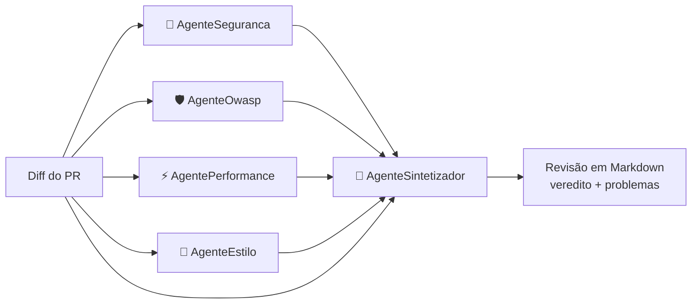

# Code Review Crew

[](https://github.com/Cosmess/code-review-crew/actions/workflows/ci.yml)


Um **revisor de código multi-agentes** construído com .NET 10 e o
[Microsoft Agent Framework](https://github.com/microsoft/agent-framework).
Agentes de IA especialistas analisam o diff de um pull request em paralelo, e um agente líder consolida
as análises em uma única revisão, sem duplicatas, pronta para ser publicada como comentário no PR.

## Como funciona



| Agente | Responsabilidade |
|---|---|
| **AgenteSeguranca** | Injeção, segredos no código, falhas de autenticação, exposição de dados sensíveis |
| **AgenteOwasp** | Audita o diff contra cada categoria do OWASP Top 10:2025 (A01–A10) e marca cada problema com a categoria |
| **AgentePerformance** | Consultas N+1, sync-over-async, alocações desnecessárias, falta de CancellationToken |
| **AgenteEstilo** | Nomenclatura, exceções engolidas, código morto, manutenibilidade |
| **AgenteSintetizador** | Une duplicatas, descarta falsos positivos, ordena por severidade e decide o veredito |

Destaques do design:

- **Orquestração fan-out / fan-in**: os especialistas rodam em paralelo; o sintetizador roda quando todos terminam.
- **Alinhado ao OWASP**: um agente dedicado mapeia cada vulnerabilidade para sua categoria do OWASP Top 10:2025 e sugere a mitigação recomendada pela OWASP.
- **Saída estruturada**: cada agente retorna JSON tipado (`ReviewFinding`, `ReviewReport`) em vez de texto livre.
- **OpenAI por padrão, independente de provedor**: construído sobre `Microsoft.Extensions.AI.IChatClient`, então também roda com Ollama (local) ou Anthropic Claude.
- **Revisões em português**: os papéis e instruções dos agentes estão em português, assim como a revisão gerada.
- **Testes determinísticos**: a orquestração é testada com um `IChatClient` fake, sem chamar nenhum LLM.

## Como usar

Requisitos: [.NET 10 SDK](https://dotnet.microsoft.com/download) e uma [chave da API da OpenAI](https://platform.openai.com/api-keys).

```bash
git clone https://github.com/Cosmess/code-review-crew.git
cd code-review-crew

# OpenAI (padrão)
export OPENAI_API_KEY=sk-...
dotnet run --project src/CodeReviewCrew.Cli -- samples/vulnerable.diff

# Alternativa: modelo local com Ollama (sem chave de API)
CRC_PROVIDER=ollama dotnet run --project src/CodeReviewCrew.Cli -- samples/vulnerable.diff

# Alternativa: Anthropic Claude
CRC_PROVIDER=anthropic ANTHROPIC_API_KEY=sk-ant-... \
  dotnet run --project src/CodeReviewCrew.Cli -- samples/vulnerable.diff
```

Também é possível enviar qualquer diff pela entrada padrão:

```bash
git diff main | dotnet run --project src/CodeReviewCrew.Cli
```

### Configuração

| Variável | Padrão | Descrição |
|---|---|---|
| `CRC_PROVIDER` | `openai` | `openai`, `ollama` ou `anthropic` |
| `CRC_MODEL` | `gpt-5-mini` (OpenAI) | Id do modelo (ex.: `gpt-5-mini`, `qwen3:8b`, `claude-sonnet-5-5`) |
| `OLLAMA_ENDPOINT` | `http://localhost:11434` | URL do servidor Ollama |
| `OPENAI_API_KEY` | | Chave da API da OpenAI (obrigatória no provedor padrão) |
| `ANTHROPIC_API_KEY` | | Chave da API da Anthropic, quando `CRC_PROVIDER=anthropic` |

## Estrutura do projeto

```
src/
  CodeReviewCrew.Core/     agentes, orquestração, modelos e renderização em Markdown
  CodeReviewCrew.Cli/      ponto de entrada da linha de comando e seleção do provedor de LLM
tests/
  CodeReviewCrew.Tests/    testes xUnit com um chat client fake
samples/
  vulnerable.diff          PR de exemplo com problemas de segurança, performance e estilo
```

## Rodando os testes

```bash
dotnet test
```

## Roadmap

- [ ] Integração com GitHub: buscar um PR pelo número e publicar a revisão como comentário
- [ ] GitHub Action para rodar a equipe de agentes em todo pull request
- [ ] AppHost do .NET Aspire com traces OpenTelemetry de cada agente
- [ ] Ferramentas MCP para os agentes lerem arquivos completos e convenções do repositório
- [ ] Suíte de avaliação medindo precisão/recall em diffs rotulados

## Licença

[MIT](LICENSE)
