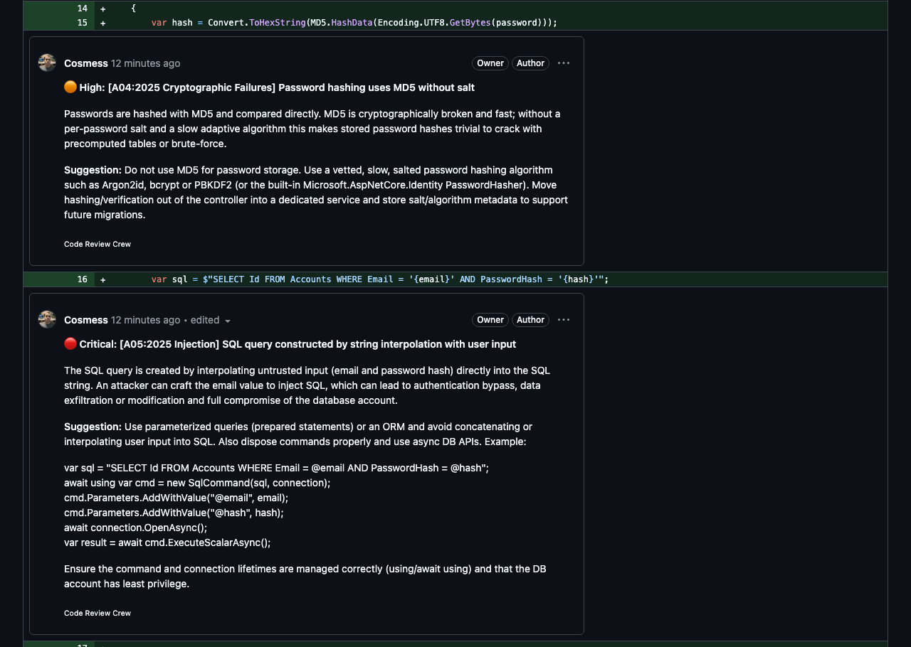
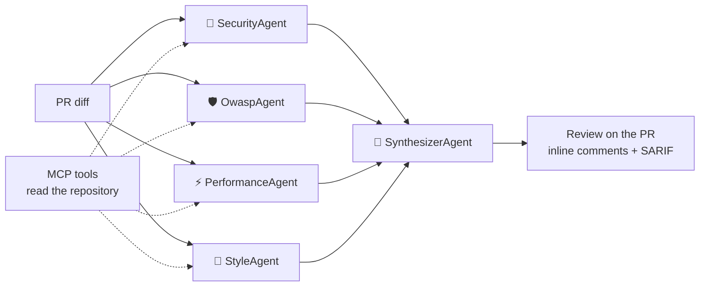

# Code Review Crew

**English** | [Português](README.pt-BR.md) | [简体中文](README.zh-CN.md)

[](https://github.com/Cosmess/code-review-crew/actions/workflows/ci.yml)


A **multi-agent AI code reviewer** for pull requests, built with .NET 10 and the
[Microsoft Agent Framework](https://github.com/microsoft/agent-framework).
Specialist agents review the diff in parallel, a lead agent consolidates their findings, and the review is
posted on the pull request with **comments on the exact line** of each issue. Reviews can be written in
English, Brazilian Portuguese or Simplified Chinese.



<sub>Real review of the [demo pull request](https://github.com/Cosmess/code-review-crew/pull/1).</sub>

## How it works



| Agent | Responsibility |
|---|---|
| **SecurityAgent** | Injection, hardcoded secrets, authentication flaws, sensitive data exposure |
| **OwaspAgent** | Audits the diff against each OWASP Top 10:2025 category (A01–A10) and tags every issue with it |
| **PerformanceAgent** | N+1 queries, sync-over-async, unnecessary allocations, missing CancellationToken |
| **StyleAgent** | Naming, swallowed exceptions, dead code, maintainability |
| **SynthesizerAgent** | Merges duplicates, discards false positives, ranks by severity and decides the verdict |

## Features

- **Inline comments** on the pull request, plus a summary with every finding and a verdict.
- **OWASP-aware**: a dedicated agent maps each vulnerability to its OWASP Top 10:2025 category.
- **SARIF output**: findings show up in the repository's *Security* tab (GitHub code scanning).
- **Repository context through MCP**: agents can read whole files, search code and read the project
  conventions through a read-only MCP server that blocks path traversal and secret files.
- **Multilingual**: reviews in English (default), Brazilian Portuguese or Simplified Chinese.
- **Resilient**: per-call timeout and retries; if an agent fails, the review continues and says so.
- **Cost control**: token usage and estimated cost per review, large diffs split into parts.
- **Observability**: OpenTelemetry traces per agent and model call, viewable in the .NET Aspire dashboard.
- **Measured quality**: an evaluation suite with labeled pull requests reports precision and recall.
- **Provider-agnostic**: OpenAI by default; Anthropic Claude and Ollama also supported.

## Quick start (GitHub Action)

1. Add an `OPENAI_API_KEY` secret to your repository (*Settings → Secrets and variables → Actions*).
2. Create `.github/workflows/code-review.yml`:

```yaml
name: Code Review Crew

on:
  pull_request:
    types: [opened, synchronize, reopened, ready_for_review]

permissions:
  contents: read
  pull-requests: write

jobs:
  review:
    runs-on: ubuntu-latest
    steps:
      - uses: actions/checkout@v4
      - uses: Cosmess/code-review-crew@v1
        with:
          openai-api-key: ${{ secrets.OPENAI_API_KEY }}
          language: en   # en, pt-BR or zh-CN
```

| Input | Default | Description |
|---|---|---|
| `openai-api-key` | required | OpenAI API key |
| `github-token` | `github.token` | Token to read the PR and post the review |
| `model` | `gpt-5-mini` | OpenAI model |
| `language` | `en` | Review language: `en`, `pt-BR` or `zh-CN` |
| `config` | `.crc.yml` | Configuration file (ignored if missing) |
| `post-review` | `true` | Post the review with inline comments |
| `read-repository` | `true` | Give the agents read-only MCP tools over the checked-out repository |
| `sarif-file` | empty | Save findings as SARIF to this path |
| `fail-on` | empty | Fail the job on findings of this severity or higher |

On Linux runners the Action pulls a prebuilt image and starts in seconds. SARIF upload, merge blocking, fork pull
requests and other runners are covered in the [GitHub Action guide](docs/en/guides/github-action.md).

## Command line

Requirements: [.NET 10 SDK](https://dotnet.microsoft.com/download) and an [OpenAI API key](https://platform.openai.com/api-keys).

```bash
git clone https://github.com/Cosmess/code-review-crew.git
cd code-review-crew
export OPENAI_API_KEY=sk-...

# Review a diff file
dotnet run --project src/CodeReviewCrew.Cli -- samples/vulnerable.diff

# Review your local changes, in Portuguese, letting the agents read the repository
git diff main | dotnet run --project src/CodeReviewCrew.Cli -- --language pt-BR --repo-path .

# Review a GitHub pull request and post the review (needs GITHUB_TOKEN)
dotnet run --project src/CodeReviewCrew.Cli -- --pr 42 --repo owner/repo --post

# Export SARIF and fail on High or Critical findings
dotnet run --project src/CodeReviewCrew.Cli -- samples/vulnerable.diff --sarif review.sarif --fail-on High
```

| Option | Description |
|---|---|
| `<diff>` | Diff file. Without it and without `--pr`, reads from standard input |
| `--pr <number>` | Review a GitHub pull request |
| `--repo <owner/name>` | Repository of the PR (default: `GITHUB_REPOSITORY`) |
| `--post` | Post the review on the PR, with inline comments |
| `--language <code>` | Review language: `en`, `pt-BR` or `zh-CN` |
| `--repo-path <dir>` | Give the agents MCP tools to read files, search code and read conventions |
| `--config <file>` | Configuration (default: `.crc.yml`, if present) |
| `--output <file>` | Save the review as Markdown |
| `--sarif <file>` | Save the findings as SARIF 2.1.0 |
| `--fail-on <severity>` | Exit code 2 on findings of this severity or higher |

| Environment variable | Default | Description |
|---|---|---|
| `OPENAI_API_KEY` | | OpenAI API key (default provider) |
| `CRC_PROVIDER` | `openai` | `openai`, `ollama` or `anthropic` |
| `CRC_MODEL` | `gpt-5-mini` | Model id (e.g. `gpt-5-mini`, `qwen3:8b`, `claude-sonnet-5-5`) |
| `GITHUB_TOKEN` | | Required by `--post` and for private repositories |
| `ANTHROPIC_API_KEY` | | Anthropic key, when `CRC_PROVIDER=anthropic` |
| `OLLAMA_ENDPOINT` | `http://localhost:11434` | Ollama server URL |
| `OTEL_EXPORTER_OTLP_ENDPOINT` | | Export traces and metrics through OTLP |

## Configuration (`.crc.yml`)

```yaml
language: en
agents: [security, owasp, performance, style]
minSeverity: Low
ignore: ["**/*.Designer.cs", "**/Migrations/**"]
maxChunkChars: 60000
agentTimeoutSeconds: 180
maxRetries: 2
pricing:            # US$ per 1 million tokens, to estimate the cost
  inputPerMillion: 0.25
  outputPerMillion: 2.00
```

Every option, including `mcpServers` to plug in external MCP servers, is documented in [`.crc.example.yml`](.crc.example.yml).

## Evaluation

The crew is measured on 12 labeled pull requests (10 with known issues and 2 clean changes):

| Metric | Result |
|---|---|
| Recall (expected issues found) | **100%** (11 / 11) |
| Precision | 58% |
| F1 | 73% |
| Correct verdicts | 92% (11 / 12) |

<sub>`gpt-5-mini`, reviews in English, October 2026. LLM output varies between runs: in the previous run of the same
version, precision was 40% and recall 91%.</sub>

Some "false positives" are real issues outside the labels (for example, a timing attack in a hash comparison),
so precision is a lower bound. Run it yourself with `dotnet run --project src/CodeReviewCrew.Evals`, or with the
**Evaluation** workflow. Details in [`evals/README.md`](evals/README.md).

## Observability

```bash
dotnet run --project src/CodeReviewCrew.AppHost
```

The .NET Aspire dashboard shows each review as a trace: a `code_review` span, one `invoke_agent` span per
agent running in parallel and one span per model call, with tokens, retries and errors.
See the [observability guide](docs/en/guides/observability.md).

## Project structure

```
src/
  CodeReviewCrew.Core/       agents, orchestration, diff, GitHub, configuration, localization, telemetry, outputs
  CodeReviewCrew.Providers/  LLM client creation (OpenAI, Anthropic, Ollama)
  CodeReviewCrew.Cli/        command line, MCP servers and OTLP export
  CodeReviewCrew.McpServer/  read-only MCP server with the repository tools
  CodeReviewCrew.AppHost/    .NET Aspire AppHost
  CodeReviewCrew.Evals/      evaluation runner
evals/cases/                 labeled pull requests
tests/                       unit tests (no network) and integration tests (real model)
docs/                        documentation in English, Portuguese and Chinese, plus ADRs
action.yml                   GitHub Action
Dockerfile                   prebuilt image used by the Action on Linux runners
AGENTS.md                    rules for AI agents working on this repository
```

## Documentation

- [Documentation index](docs/en/README.md): architecture, coding standards, testing and guides
- [Architecture decision records](docs/adr/)

## Roadmap

- [x] GitHub integration with inline comments and a ready-to-use GitHub Action
- [x] Resilience, cost control and per-repository configuration
- [x] SARIF output for GitHub code scanning
- [x] OpenTelemetry traces and .NET Aspire dashboard
- [x] MCP tools to read the repository
- [x] Evaluation suite with labeled pull requests
- [x] Reviews in English, Portuguese and Chinese
- [x] Prebuilt container image so the Action starts in seconds
- [ ] More labeled cases (other languages and frameworks)

## Contributing

Contributions are welcome: see [CONTRIBUTING.md](CONTRIBUTING.md). Report vulnerabilities privately, as described in
[SECURITY.md](SECURITY.md). Changes are listed in the [changelog](CHANGELOG.md).

## License

[MIT](LICENSE)
