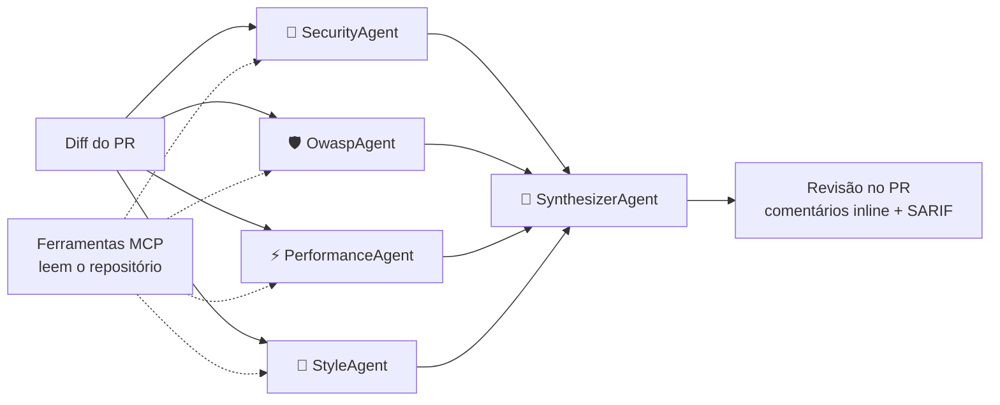

# Code Review Crew

[English](README.md) | **Português** | [简体中文](README.zh-CN.md)

[](https://github.com/Cosmess/code-review-crew/actions/workflows/ci.yml)


Um **revisor de código multi-agentes com IA** para pull requests, construído com .NET 10 e o
[Microsoft Agent Framework](https://github.com/microsoft/agent-framework).
Agentes especialistas analisam o diff em paralelo, um agente líder consolida as análises, e a revisão é
publicada no pull request com **comentários na linha exata** de cada problema. As revisões podem ser escritas
em inglês, português do Brasil ou chinês simplificado.


<sub>Revisão real do [pull request de demonstração](https://github.com/Cosmess/code-review-crew/pull/1).</sub>

## Como funciona



| Agente | Responsabilidade |
|---|---|
| **SecurityAgent** | Injeção, segredos no código, falhas de autenticação, exposição de dados sensíveis |
| **OwaspAgent** | Audita o diff contra cada categoria do OWASP Top 10:2025 (A01–A10) e marca cada problema com ela |
| **PerformanceAgent** | Consultas N+1, sync-over-async, alocações desnecessárias, falta de CancellationToken |
| **StyleAgent** | Nomenclatura, exceções engolidas, código morto, manutenibilidade |
| **SynthesizerAgent** | Une duplicatas, descarta falsos positivos, ordena por severidade e decide o veredito |

## Funcionalidades

- **Comentários inline** no pull request, mais um resumo com todos os problemas e um veredito.
- **Alinhado ao OWASP**: um agente dedicado associa cada vulnerabilidade à sua categoria do OWASP Top 10:2025.
- **Saída em SARIF**: os problemas aparecem na aba *Security* do repositório (GitHub code scanning).
- **Contexto do repositório via MCP**: os agentes leem arquivos completos, buscam código e leem as convenções
  do projeto por um servidor MCP somente leitura, que bloqueia path traversal e arquivos de segredos.
- **Multilíngue**: revisões em inglês (padrão), português do Brasil ou chinês simplificado.
- **Resiliente**: timeout e novas tentativas por chamada; se um agente falhar, a revisão segue e avisa.
- **Controle de custo**: tokens e custo estimado por revisão, diffs grandes divididos em partes.
- **Observabilidade**: traces OpenTelemetry por agente e por chamada ao modelo, no dashboard do .NET Aspire.
- **Qualidade medida**: uma suíte de avaliação com pull requests rotulados mede precisão e recall.
- **Independente de provedor**: OpenAI por padrão; Anthropic Claude e Ollama também são suportados.

## Início rápido (GitHub Action)

1. Crie o secret `OPENAI_API_KEY` no repositório (*Settings → Secrets and variables → Actions*).
2. Crie `.github/workflows/code-review.yml`:

```yaml
name: Code Review Crew

on:
  pull_request:
    types: [opened, synchronize, reopened, ready_for_review]

permissions:
  contents: read
  pull-requests: write

jobs:
  review:
    runs-on: ubuntu-latest
    steps:
      - uses: actions/checkout@v4
      - uses: Cosmess/code-review-crew@v1
        with:
          openai-api-key: ${{ secrets.OPENAI_API_KEY }}
          language: pt-BR   # en, pt-BR ou zh-CN
```

| Input | Padrão | Descrição |
|---|---|---|
| `openai-api-key` | obrigatório | Chave da API da OpenAI |
| `github-token` | `github.token` | Token para ler o PR e publicar a revisão |
| `model` | `gpt-5-mini` | Modelo da OpenAI |
| `language` | `en` | Idioma da revisão: `en`, `pt-BR` ou `zh-CN` |
| `config` | `.crc.yml` | Arquivo de configuração (ignorado se não existir) |
| `post-review` | `true` | Publica a revisão com comentários inline |
| `read-repository` | `true` | Dá aos agentes ferramentas MCP somente leitura sobre o repositório |
| `sarif-file` | vazio | Salva os problemas em SARIF neste caminho |
| `fail-on` | vazio | Falha o job com problemas desta severidade ou maior |

Em runners Linux, a Action baixa uma imagem pronta e começa em segundos. Envio de SARIF, bloqueio de merge, PRs de
forks e outros runners estão no [guia da GitHub Action](docs/pt-BR/guides/github-action.md).

## Linha de comando

Requisitos: [.NET 10 SDK](https://dotnet.microsoft.com/download) e uma [chave da API da OpenAI](https://platform.openai.com/api-keys).

```bash
git clone https://github.com/Cosmess/code-review-crew.git
cd code-review-crew
export OPENAI_API_KEY=sk-...

# Revisar um arquivo de diff
dotnet run --project src/CodeReviewCrew.Cli -- samples/vulnerable.diff

# Revisar as mudanças locais, em português, deixando os agentes lerem o repositório
git diff main | dotnet run --project src/CodeReviewCrew.Cli -- --language pt-BR --repo-path .

# Revisar um PR do GitHub e publicar a revisão (precisa de GITHUB_TOKEN)
dotnet run --project src/CodeReviewCrew.Cli -- --pr 42 --repo dono/repositorio --post

# Exportar SARIF e falhar com problemas High ou Critical
dotnet run --project src/CodeReviewCrew.Cli -- samples/vulnerable.diff --sarif revisao.sarif --fail-on High
```

| Opção | Descrição |
|---|---|
| `<diff>` | Arquivo de diff. Sem ele e sem `--pr`, lê da entrada padrão |
| `--pr <número>` | Revisa um pull request do GitHub |
| `--repo <dono/nome>` | Repositório do PR (padrão: `GITHUB_REPOSITORY`) |
| `--post` | Publica a revisão no PR, com comentários inline |
| `--language <código>` | Idioma da revisão: `en`, `pt-BR` ou `zh-CN` |
| `--repo-path <dir>` | Dá aos agentes ferramentas MCP para ler arquivos, buscar código e ler convenções |
| `--config <arquivo>` | Configuração (padrão: `.crc.yml`, se existir) |
| `--output <arquivo>` | Salva a revisão em Markdown |
| `--sarif <arquivo>` | Salva os problemas em SARIF 2.1.0 |
| `--fail-on <severidade>` | Código de saída 2 com problemas dessa severidade ou maior |

| Variável de ambiente | Padrão | Descrição |
|---|---|---|
| `OPENAI_API_KEY` | | Chave da API da OpenAI (provedor padrão) |
| `CRC_PROVIDER` | `openai` | `openai`, `ollama` ou `anthropic` |
| `CRC_MODEL` | `gpt-5-mini` | Id do modelo (ex.: `gpt-5-mini`, `qwen3:8b`, `claude-sonnet-5-5`) |
| `GITHUB_TOKEN` | | Necessário para `--post` e para repositórios privados |
| `ANTHROPIC_API_KEY` | | Chave da Anthropic, quando `CRC_PROVIDER=anthropic` |
| `OLLAMA_ENDPOINT` | `http://localhost:11434` | URL do servidor Ollama |
| `OTEL_EXPORTER_OTLP_ENDPOINT` | | Exporta traces e métricas via OTLP |

## Configuração (`.crc.yml`)

```yaml
language: pt-BR
agents: [security, owasp, performance, style]
minSeverity: Low
ignore: ["**/*.Designer.cs", "**/Migrations/**"]
maxChunkChars: 60000
agentTimeoutSeconds: 180
maxRetries: 2
pricing:            # US$ por 1 milhão de tokens, para estimar o custo
  inputPerMillion: 0.25
  outputPerMillion: 2.00
```

Todas as opções, incluindo `mcpServers` para plugar servidores MCP externos, estão em [`.crc.example.yml`](.crc.example.yml).

## Avaliação

A equipe é medida em 12 pull requests rotulados (10 com problemas conhecidos e 2 mudanças limpas):

| Métrica | Resultado |
|---|---|
| Recall (problemas esperados encontrados) | **100%** (11 / 11) |
| Precisão | 58% |
| F1 | 73% |
| Vereditos corretos | 92% (11 / 12) |

<sub>`gpt-5-mini`, revisões em inglês, outubro de 2026. A saída do LLM varia entre execuções: na execução anterior
da mesma versão, a precisão foi de 40% e o recall de 91%.</sub>

Alguns "falsos positivos" são problemas reais fora dos rótulos (por exemplo, timing attack em uma comparação
de hash), então a precisão é um limite inferior. Rode você mesmo com `dotnet run --project src/CodeReviewCrew.Evals`
ou pelo workflow **Evaluation**. Detalhes em [`evals/README.pt-BR.md`](evals/README.pt-BR.md).

## Observabilidade

```bash
dotnet run --project src/CodeReviewCrew.AppHost
```

O dashboard do .NET Aspire mostra cada revisão como um trace: um span `code_review`, um span `invoke_agent`
por agente rodando em paralelo e um span por chamada ao modelo, com tokens, retries e erros.
Veja o [guia de observabilidade](docs/pt-BR/guides/observability.md).

## Estrutura do projeto

```
src/
  CodeReviewCrew.Core/       agentes, orquestração, diff, GitHub, configuração, idiomas, telemetria, saídas
  CodeReviewCrew.Providers/  criação do cliente de LLM (OpenAI, Anthropic, Ollama)
  CodeReviewCrew.Cli/        linha de comando, servidores MCP e exportação OTLP
  CodeReviewCrew.McpServer/  servidor MCP somente leitura com as ferramentas do repositório
  CodeReviewCrew.AppHost/    AppHost do .NET Aspire
  CodeReviewCrew.Evals/      runner da avaliação
evals/cases/                 pull requests rotulados
tests/                       testes unitários (sem rede) e de integração (modelo real)
docs/                        documentação em inglês, português e chinês, mais os ADRs
action.yml                   GitHub Action
Dockerfile                   imagem pronta usada pela Action em runners Linux
AGENTS.md                    regras para agentes de IA que trabalham neste repositório
```

## Documentação

- [Índice da documentação](docs/pt-BR/README.md): arquitetura, padrões de código, testes e guias
- [Registros de decisões de arquitetura](docs/adr/) (em inglês)

## Roadmap

- [x] Integração com GitHub com comentários inline e GitHub Action pronta para uso
- [x] Resiliência, controle de custo e configuração por repositório
- [x] Saída em SARIF para o GitHub code scanning
- [x] Traces OpenTelemetry e dashboard do .NET Aspire
- [x] Ferramentas MCP para ler o repositório
- [x] Suíte de avaliação com pull requests rotulados
- [x] Revisões em inglês, português e chinês
- [x] Imagem de contêiner pronta para a Action iniciar em segundos
- [ ] Mais casos rotulados (outras linguagens e frameworks)

## Contribuindo

Contribuições são bem-vindas: veja o [CONTRIBUTING.md](CONTRIBUTING.md) (em inglês). Relate vulnerabilidades de forma
privada, como descrito no [SECURITY.md](SECURITY.md). As mudanças de cada versão estão no [changelog](CHANGELOG.md).

## Licença

[MIT](LICENSE)
