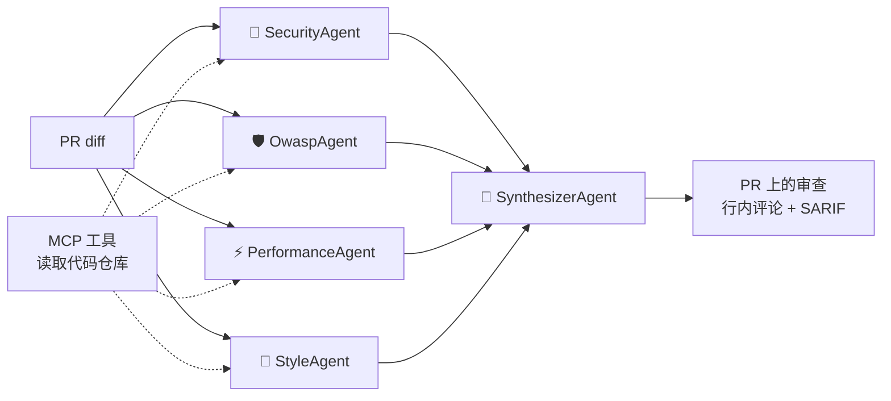

# Code Review Crew

[English](README.md) | [Português](README.pt-BR.md) | **简体中文**

[](https://github.com/Cosmess/code-review-crew/actions/workflows/ci.yml)


一个面向 Pull Request 的**多智能体 AI 代码审查工具**，基于 .NET 10 和
[Microsoft Agent Framework](https://github.com/microsoft/agent-framework) 构建。
多个专家智能体并行分析 diff，由一个主审智能体汇总结果，并将审查意见以**行内评论**的形式发布到
Pull Request 中每个问题所在的代码行。审查结果可以使用英语、巴西葡萄牙语或简体中文撰写。


<sub>[演示 Pull Request](https://github.com/Cosmess/code-review-crew/pull/1) 的真实审查结果。</sub>

## 工作原理



| 智能体 | 职责 |
|---|---|
| **SecurityAgent** | 注入、硬编码密钥、认证缺陷、敏感数据泄露 |
| **OwaspAgent** | 按 OWASP Top 10:2025 的各个类别（A01–A10）审计 diff，并为每个问题标注类别 |
| **PerformanceAgent** | N+1 查询、sync-over-async、不必要的内存分配、缺少 CancellationToken |
| **StyleAgent** | 命名、被吞掉的异常、死代码、可维护性 |
| **SynthesizerAgent** | 合并重复项、剔除误报、按严重程度排序并给出结论 |

## 功能特性

- **行内评论**：在 Pull Request 中逐行评论，并附带包含所有问题和结论的总结。
- **OWASP 感知**：专门的智能体将每个漏洞对应到 OWASP Top 10:2025 的类别。
- **SARIF 输出**：问题会显示在仓库的 *Security* 标签页（GitHub code scanning）中。
- **通过 MCP 获取仓库上下文**：智能体可以通过只读的 MCP 服务器读取完整文件、搜索代码并阅读项目规范，
  该服务器会阻止路径穿越并屏蔽密钥类文件。
- **多语言**：审查结果支持英语（默认）、巴西葡萄牙语和简体中文。
- **高可用**：每次调用都有超时和重试；即使某个智能体失败，审查也会继续并给出提示。
- **成本控制**：统计每次审查的 token 用量和预估费用，大型 diff 会被拆分处理。
- **可观测性**：按智能体和模型调用生成 OpenTelemetry 追踪，可在 .NET Aspire 仪表板中查看。
- **质量可度量**：基于带标注的 Pull Request 的评估套件，报告精确率和召回率。
- **不绑定模型提供商**：默认使用 OpenAI，同时支持 Anthropic Claude 和 Ollama。

## 快速开始（GitHub Action）

1. 在仓库中添加 `OPENAI_API_KEY` secret（*Settings → Secrets and variables → Actions*）。
2. 创建 `.github/workflows/code-review.yml`：

```yaml
name: Code Review Crew

on:
  pull_request:
    types: [opened, synchronize, reopened, ready_for_review]

permissions:
  contents: read
  pull-requests: write

jobs:
  review:
    runs-on: ubuntu-latest
    steps:
      - uses: actions/checkout@v4
      - uses: Cosmess/code-review-crew@v1
        with:
          openai-api-key: ${{ secrets.OPENAI_API_KEY }}
          language: zh-CN   # en、pt-BR 或 zh-CN
```

| 输入 | 默认值 | 说明 |
|---|---|---|
| `openai-api-key` | 必填 | OpenAI API 密钥 |
| `github-token` | `github.token` | 用于读取 PR 并发布审查的令牌 |
| `model` | `gpt-5-mini` | OpenAI 模型 |
| `language` | `en` | 审查语言：`en`、`pt-BR` 或 `zh-CN` |
| `config` | `.crc.yml` | 配置文件（不存在时忽略） |
| `post-review` | `true` | 发布带行内评论的审查 |
| `read-repository` | `true` | 为智能体提供只读的仓库 MCP 工具 |
| `sarif-file` | 空 | 将问题以 SARIF 格式保存到该路径 |
| `fail-on` | 空 | 存在该严重程度及以上的问题时使任务失败 |

SARIF 上传、阻止合并以及来自 fork 的 Pull Request，请参阅 [GitHub Action 指南](docs/zh-CN/guides/github-action.md)。

## 命令行

环境要求：[.NET 10 SDK](https://dotnet.microsoft.com/download) 和 [OpenAI API 密钥](https://platform.openai.com/api-keys)。

```bash
git clone https://github.com/Cosmess/code-review-crew.git
cd code-review-crew
export OPENAI_API_KEY=sk-...

# 审查一个 diff 文件
dotnet run --project src/CodeReviewCrew.Cli -- samples/vulnerable.diff

# 用中文审查本地改动，并允许智能体读取仓库
git diff main | dotnet run --project src/CodeReviewCrew.Cli -- --language zh-CN --repo-path .

# 审查 GitHub 上的 Pull Request 并发布审查（需要 GITHUB_TOKEN）
dotnet run --project src/CodeReviewCrew.Cli -- --pr 42 --repo owner/repo --post

# 导出 SARIF，并在存在 High 或 Critical 问题时失败
dotnet run --project src/CodeReviewCrew.Cli -- samples/vulnerable.diff --sarif review.sarif --fail-on High
```

| 选项 | 说明 |
|---|---|
| `<diff>` | diff 文件。不提供该文件且未使用 `--pr` 时，从标准输入读取 |
| `--pr <编号>` | 审查 GitHub 上的 Pull Request |
| `--repo <owner/name>` | PR 所在仓库（默认：`GITHUB_REPOSITORY`） |
| `--post` | 在 PR 上发布带行内评论的审查 |
| `--language <代码>` | 审查语言：`en`、`pt-BR` 或 `zh-CN` |
| `--repo-path <目录>` | 为智能体提供读取文件、搜索代码和阅读规范的 MCP 工具 |
| `--config <文件>` | 配置文件（默认：存在时使用 `.crc.yml`） |
| `--output <文件>` | 将审查保存为 Markdown |
| `--sarif <文件>` | 将问题保存为 SARIF 2.1.0 |
| `--fail-on <严重程度>` | 存在该严重程度及以上的问题时以退出码 2 结束 |

| 环境变量 | 默认值 | 说明 |
|---|---|---|
| `OPENAI_API_KEY` | | OpenAI API 密钥（默认提供商） |
| `CRC_PROVIDER` | `openai` | `openai`、`ollama` 或 `anthropic` |
| `CRC_MODEL` | `gpt-5-mini` | 模型 id（如 `gpt-5-mini`、`qwen3:8b`、`claude-sonnet-5-5`） |
| `GITHUB_TOKEN` | | 使用 `--post` 或访问私有仓库时必需 |
| `ANTHROPIC_API_KEY` | | 当 `CRC_PROVIDER=anthropic` 时使用的 Anthropic 密钥 |
| `OLLAMA_ENDPOINT` | `http://localhost:11434` | Ollama 服务器地址 |
| `OTEL_EXPORTER_OTLP_ENDPOINT` | | 通过 OTLP 导出追踪和指标 |

## 配置（`.crc.yml`）

```yaml
language: zh-CN
agents: [security, owasp, performance, style]
minSeverity: Low
ignore: ["**/*.Designer.cs", "**/Migrations/**"]
maxChunkChars: 60000
agentTimeoutSeconds: 180
maxRetries: 2
pricing:            # 每 100 万 token 的美元价格，用于估算费用
  inputPerMillion: 0.25
  outputPerMillion: 2.00
```

所有选项（包括用于接入外部 MCP 服务器的 `mcpServers`）都在 [`.crc.example.yml`](.crc.example.yml) 中有说明。

## 评估

我们在 12 个带标注的 Pull Request 上评估这组智能体（10 个包含已知问题，2 个为无问题的改动）：

| 指标 | 结果 |
|---|---|
| 召回率（发现的预期问题） | **100%**（11 / 11） |
| 精确率 | 58% |
| F1 | 73% |
| 结论正确率 | 92%（11 / 12） |

<sub>`gpt-5-mini`，英文审查，2026 年 10 月。LLM 的输出在不同运行之间会有差异：同一版本的上一次运行中，
精确率为 40%，召回率为 91%。</sub>

部分“误报”其实是标注之外的真实问题（例如哈希比较中的时序攻击），因此精确率是一个下限。
你可以通过 `dotnet run --project src/CodeReviewCrew.Evals` 或 **Evaluation** 工作流自行运行。
详见 [`evals/README.zh-CN.md`](evals/README.zh-CN.md)。

## 可观测性

```bash
dotnet run --project src/CodeReviewCrew.AppHost
```

.NET Aspire 仪表板会将每次审查显示为一条追踪：一个 `code_review` span、每个并行运行的智能体对应一个
`invoke_agent` span，以及每次模型调用对应一个 span，并包含 token、重试和错误信息。
参见[可观测性指南](docs/zh-CN/guides/observability.md)。

## 项目结构

```
src/
  CodeReviewCrew.Core/       智能体、编排、diff、GitHub、配置、多语言、遥测和输出
  CodeReviewCrew.Providers/  创建 LLM 客户端（OpenAI、Anthropic、Ollama）
  CodeReviewCrew.Cli/        命令行、MCP 服务器和 OTLP 导出
  CodeReviewCrew.McpServer/  提供仓库工具的只读 MCP 服务器
  CodeReviewCrew.AppHost/    .NET Aspire AppHost
  CodeReviewCrew.Evals/      评估运行器
evals/cases/                 带标注的 Pull Request
tests/                       单元测试（无网络）和集成测试（真实模型）
docs/                        英文、葡萄牙文和中文文档，以及 ADR
action.yml                   GitHub Action
AGENTS.md                    在本仓库中工作的 AI 智能体需遵守的规则
```

## 文档

- [文档索引](docs/zh-CN/README.md)：架构、编码规范、测试和指南
- [架构决策记录](docs/adr/)（英文）

## 路线图

- [x] 集成 GitHub，支持行内评论，并提供开箱即用的 GitHub Action
- [x] 高可用、成本控制和按仓库配置
- [x] 为 GitHub code scanning 提供 SARIF 输出
- [x] OpenTelemetry 追踪和 .NET Aspire 仪表板
- [x] 用于读取仓库的 MCP 工具
- [x] 基于带标注 Pull Request 的评估套件
- [x] 支持英语、葡萄牙语和中文的审查
- [ ] 预构建容器镜像，加快 Action 启动速度
- [ ] 更多带标注的用例（其他语言和框架）

## 许可证

[MIT](LICENSE)
