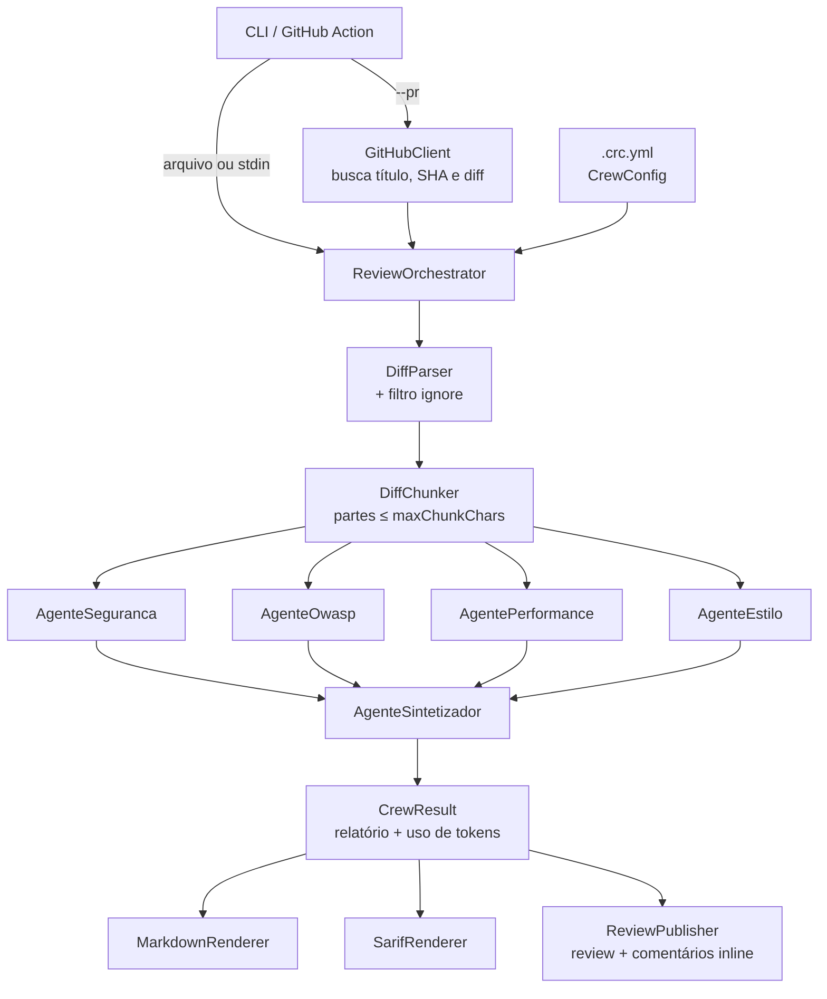

# Arquitetura

## Visão geral

## Fluxo de uma revisão

1. **Entrada.** A CLI obtém o diff de um arquivo, da entrada padrão ou do GitHub (`--pr`).
2. **Configuração.** `CrewConfig` vem do `.crc.yml` (ou usa os padrões).
3. **Preparação do diff.** `DiffParser` separa por arquivo e registra as linhas comentáveis; arquivos que
   batem com `ignore` saem; `DiffChunker` agrupa os arquivos em partes de até `maxChunkChars`.
4. **Fan-out.** Cada especialista roda em paralelo (`Task.WhenAll`) e analisa cada parte em sequência.
   Cada chamada passa pelo `RetryPolicy` (timeout + retry com backoff exponencial).
5. **Fan-in.** O `AgenteSintetizador` recebe as análises (e o diff, se couber em uma parte), une duplicatas,
   descarta falsos positivos e decide o veredito. Ele não é chamado se nenhum especialista encontrou nada.
6. **Pós-processamento.** Aplica `minSeverity` e soma os tokens (`UsageTracker`) e o custo estimado.
7. **Saídas.** Markdown no stdout (e no `GITHUB_STEP_SUMMARY`), SARIF opcional e, com `--post`, uma review
   no PR. Problemas em linhas do diff viram comentários inline; o resto vai para o corpo da review.

## Tratamento de falhas

| Falha | Comportamento |
|---|---|
| Timeout ou erro transitório | Nova tentativa até `maxRetries`, com backoff de 2, 4, 8... segundos |
| Especialista falha em todas as tentativas | `SpecialistReport.Error` preenchido; a revisão segue com os demais e mostra um aviso |
| Todos os especialistas falham | Relatório com veredito `Comment` explicando que não houve análise |
| Sintetizador falha | Análises dos especialistas unidas sem consolidação (`DistinctBy` + ordenação por severidade) |
| GitHub recusa um comentário inline (422) | A review é publicada novamente, só com o corpo |
| Cancelamento pelo usuário (Ctrl+C) | Não há retry; a operação é cancelada |

## Camadas e dependências

- **`CodeReviewCrew.Core`** concentra toda a lógica. Depende de `Microsoft.Agents.AI`,
  `Microsoft.Extensions.AI` (abstração `IChatClient`), YamlDotNet e FileSystemGlobbing.
  **Não** referencia SDKs de provedores.
- **`CodeReviewCrew.Cli`** é a composição: lê opções, cria o `IChatClient` do provedor escolhido
  (`ChatClientFactory`) e liga as saídas. Deve continuar fina.
- **`action.yml`** só monta os argumentos da CLI a partir dos inputs da action.

## Saída estruturada

Os agentes usam `RunAsync<T>` do Agent Framework, que pede ao modelo um JSON no schema do tipo `T`:
`SpecialistFindings` para especialistas e `ReviewReport` para o sintetizador. Os enums (`Severity`,
`Verdict`) são serializados como string. As descrições em `[Description]` entram no schema e orientam o modelo.
