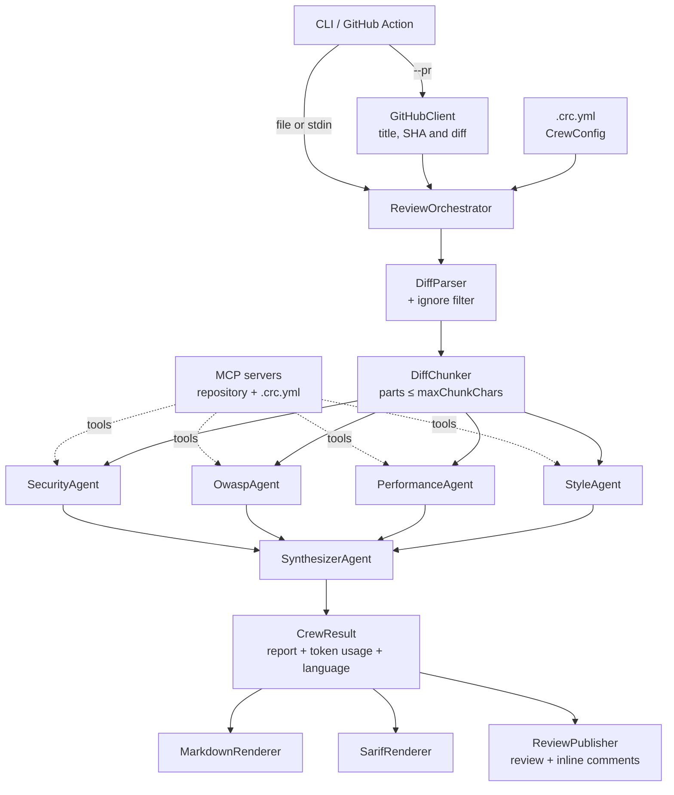

# Architecture

**English** | [Português](../pt-BR/architecture.md) | [简体中文](../zh-CN/architecture.md)

## Overview

## The flow of a review

1. **Input.** The CLI gets the diff from a file, standard input or GitHub (`--pr`).
2. **Configuration.** `CrewConfig` comes from `.crc.yml` (or the defaults); `--language` overrides the language.
3. **Diff preparation.** `DiffParser` splits the diff by file and records the commentable lines; files matching
   `ignore` are dropped; `DiffChunker` groups the files into parts of up to `maxChunkChars`.
4. **Fan-out.** The specialists run in parallel (`Task.WhenAll`), each analyzing every part in sequence.
   Every call goes through `RetryPolicy` (timeout + retry with exponential backoff).
5. **Fan-in.** `SynthesizerAgent` receives the findings (and the diff, if it fits in one part), merges duplicates,
   discards false positives and decides the verdict. It is not called when no specialist found anything.
6. **Post-processing.** Titles are normalized, `minSeverity` is applied and tokens (`UsageTracker`) and the
   estimated cost are added up.
7. **Outputs.** Markdown on stdout (and in `GITHUB_STEP_SUMMARY`), optional SARIF and, with `--post`, a review
   on the PR. Findings on lines that are part of the diff become inline comments; the rest go to the body.

## Languages

Agent instructions are always in English. `ReviewLanguage` (`en`, `pt-BR`, `zh-CN`) appends one sentence asking
the agents to write the findings in the chosen language, and `ReviewStrings` translates every text the crew
writes itself: Markdown labels, verdicts, severities, fallback summaries and SARIF messages. To add a language,
add a `ReviewLanguage` and its `ReviewStrings`.

## MCP tools

With `--repo-path` (on by default in the GitHub Action), the CLI's `McpToolHost` starts
`CodeReviewCrew.McpServer` over stdio and gives its tools to the specialists: `read_file`, `search_code`,
`list_directory` and `read_conventions`. `ChatClientAgent` runs the tool calls automatically. Extra servers
from `.crc.yml` (`mcpServers`) are added the same way. The synthesizer gets no tools.

The pull request is untrusted content, so:

- `RepositoryReader` only reads inside the root and refuses symbolic links, `.git` and secret files;
- MCP processes do not inherit environment variables (API keys and `GITHUB_TOKEN` stay in the CLI process);
- the agents' instructions treat the diff and files as data, never as instructions;
- a server that fails to start is skipped with a warning, without taking the review down.

## Observability

`CrewTelemetry` (Core) defines the `CodeReviewCrew` `ActivitySource` and `Meter`:

| Span | Contents |
|---|---|
| `code_review` | Root: files, parts, verdict, findings and tokens |
| `invoke_agent <agent>` | One per agent; `retry` events, error status and number of findings |
| `chat <model>` | One per model call (`UseOpenTelemetry` from Microsoft.Extensions.AI), without prompts or code |

Metrics: `crc.tokens.input`, `crc.tokens.output`, `crc.findings` (by agent and severity),
`crc.agent.failures` and `crc.agent.duration`. The CLI exports through OTLP when `OTEL_EXPORTER_OTLP_ENDPOINT`
is set; the Aspire AppHost sets it and shows everything in its dashboard.

## Failure handling

| Failure | Behavior |
|---|---|
| Timeout or transient error | Retried up to `maxRetries` times, with 2, 4, 8... second backoff |
| A specialist fails on every attempt | `SpecialistReport.Error` is set; the review continues with the others and shows a warning |
| Every specialist fails | Report with a `Comment` verdict explaining that no analysis was done |
| The synthesizer fails | The specialists' findings are merged without consolidation |
| GitHub rejects an inline comment (422) | The review is posted again with the body only |
| User cancellation (Ctrl+C) | No retry; the operation is cancelled |
| An MCP server does not start | Warning on stderr; the review continues without its tools |

## Projects and dependencies

- **`CodeReviewCrew.Core`** holds all the logic. It depends on `Microsoft.Agents.AI`, `Microsoft.Extensions.AI`
  (the `IChatClient` abstraction), YamlDotNet and FileSystemGlobbing. It does **not** reference provider SDKs.
- **`CodeReviewCrew.Providers`** creates each provider's `IChatClient` (`ChatClientFactory`) and holds the SDKs.
- **`CodeReviewCrew.Cli`** is the composition root: it reads options, starts MCP servers, configures OTLP and wires
  the outputs. It must stay thin.
- **`CodeReviewCrew.McpServer`** is a separate process speaking MCP over stdio.
- **`CodeReviewCrew.AppHost`** and **`CodeReviewCrew.Evals`** are entry points for observability and evaluation.
- **`action.yml`** only turns the Action inputs into CLI arguments. On Linux runners it runs the CLI from the prebuilt
  image (`Dockerfile`, published by the `Container image` workflow); elsewhere it builds the CLI from source. See
  [ADR 0008](../adr/0008-prebuilt-container-image.md).

## Structured output

Agents use the Agent Framework's `RunAsync<T>`, which asks the model for JSON matching the schema of `T`:
`SpecialistFindings` for specialists and `ReviewReport` for the synthesizer. Enums (`Severity`, `Verdict`) are
serialized as strings, and `[Description]` attributes become part of the schema that guides the model.
