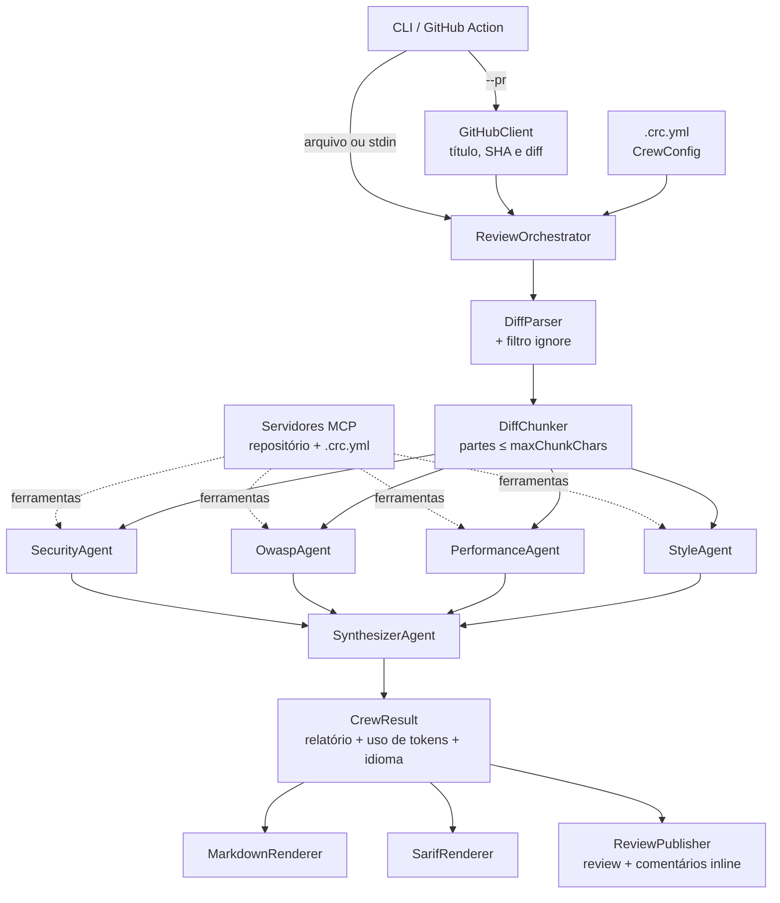

# Arquitetura

[English](../en/architecture.md) | **Português** | [简体中文](../zh-CN/architecture.md)

## Visão geral

## Fluxo de uma revisão

1. **Entrada.** A CLI obtém o diff de um arquivo, da entrada padrão ou do GitHub (`--pr`).
2. **Configuração.** `CrewConfig` vem do `.crc.yml` (ou dos padrões); `--language` sobrescreve o idioma.
3. **Preparação do diff.** `DiffParser` separa por arquivo e registra as linhas comentáveis; arquivos que batem
   com `ignore` saem; `DiffChunker` agrupa os arquivos em partes de até `maxChunkChars`.
4. **Fan-out.** Os especialistas rodam em paralelo (`Task.WhenAll`), cada um analisando todas as partes em sequência.
   Toda chamada passa pelo `RetryPolicy` (timeout + retry com backoff exponencial).
5. **Fan-in.** O `SynthesizerAgent` recebe as análises (e o diff, se couber em uma parte), une duplicatas,
   descarta falsos positivos e decide o veredito. Ele não é chamado se nenhum especialista encontrou nada.
6. **Pós-processamento.** Os títulos são normalizados, `minSeverity` é aplicado e os tokens (`UsageTracker`) e o
   custo estimado são somados.
7. **Saídas.** Markdown no stdout (e no `GITHUB_STEP_SUMMARY`), SARIF opcional e, com `--post`, uma review no PR.
   Problemas em linhas do diff viram comentários inline; o resto vai para o corpo.

## Idiomas

As instruções dos agentes são sempre em inglês. O `ReviewLanguage` (`en`, `pt-BR`, `zh-CN`) acrescenta uma frase
pedindo que os agentes escrevam no idioma escolhido, e o `ReviewStrings` traduz todo texto que a própria equipe
escreve: rótulos do Markdown, vereditos, severidades, resumos de fallback e mensagens do SARIF. Para adicionar um
idioma, crie um `ReviewLanguage` e o seu `ReviewStrings`.

## Ferramentas MCP

Com `--repo-path` (ligado por padrão na GitHub Action), o `McpToolHost` da CLI inicia o `CodeReviewCrew.McpServer`
por stdio e entrega as ferramentas aos especialistas: `read_file`, `search_code`, `list_directory` e
`read_conventions`. O `ChatClientAgent` executa as chamadas de ferramenta automaticamente. Servidores extras do
`.crc.yml` (`mcpServers`) entram da mesma forma. O sintetizador não recebe ferramentas.

O pull request é conteúdo não confiável, então:

- o `RepositoryReader` só lê dentro da raiz e recusa links simbólicos, `.git` e arquivos de segredos;
- os processos MCP não herdam variáveis de ambiente (chaves de API e `GITHUB_TOKEN` ficam no processo da CLI);
- as instruções dos agentes tratam diff e arquivos como dados, nunca como instruções;
- um servidor que não inicia é ignorado com aviso, sem derrubar a revisão.

## Observabilidade

O `CrewTelemetry` (Core) define o `ActivitySource` e o `Meter` `CodeReviewCrew`:

| Span | Conteúdo |
|---|---|
| `code_review` | Raiz: arquivos, partes, veredito, problemas e tokens |
| `invoke_agent <agente>` | Um por agente; eventos `retry`, status de erro e número de problemas |
| `chat <modelo>` | Um por chamada ao modelo (`UseOpenTelemetry` do Microsoft.Extensions.AI), sem prompts nem código |

Métricas: `crc.tokens.input`, `crc.tokens.output`, `crc.findings` (por agente e severidade),
`crc.agent.failures` e `crc.agent.duration`. A CLI exporta via OTLP quando `OTEL_EXPORTER_OTLP_ENDPOINT` existe;
o AppHost do Aspire define essa variável e mostra tudo no dashboard.

## Tratamento de falhas

| Falha | Comportamento |
|---|---|
| Timeout ou erro transitório | Nova tentativa até `maxRetries`, com backoff de 2, 4, 8... segundos |
| Especialista falha em todas as tentativas | `SpecialistReport.Error` preenchido; a revisão segue com os demais e mostra um aviso |
| Todos os especialistas falham | Relatório com veredito `Comment` explicando que não houve análise |
| Sintetizador falha | As análises dos especialistas são unidas sem consolidação |
| GitHub recusa um comentário inline (422) | A review é publicada novamente, só com o corpo |
| Cancelamento pelo usuário (Ctrl+C) | Sem retry; a operação é cancelada |
| Servidor MCP não inicia | Aviso no stderr; a revisão segue sem as ferramentas dele |

## Projetos e dependências

- **`CodeReviewCrew.Core`** concentra toda a lógica. Depende de `Microsoft.Agents.AI`, `Microsoft.Extensions.AI`
  (abstração `IChatClient`), YamlDotNet e FileSystemGlobbing. **Não** referencia SDKs de provedores.
- **`CodeReviewCrew.Providers`** cria o `IChatClient` de cada provedor (`ChatClientFactory`) e concentra os SDKs.
- **`CodeReviewCrew.Cli`** é a composição: lê opções, inicia os servidores MCP, configura o OTLP e liga as saídas.
  Deve continuar fina.
- **`CodeReviewCrew.McpServer`** é um processo separado, falando MCP por stdio.
- **`CodeReviewCrew.AppHost`** e **`CodeReviewCrew.Evals`** são pontos de entrada para observabilidade e avaliação.
- **`action.yml`** só transforma os inputs da Action em argumentos da CLI. Em runners Linux, roda a CLI a partir da
  imagem pronta (`Dockerfile`, publicada pelo workflow `Container image`); nos demais, compila a CLI a partir do código.
  Veja o [ADR 0008](../adr/0008-prebuilt-container-image.md).

## Saída estruturada

Os agentes usam o `RunAsync<T>` do Agent Framework, que pede ao modelo um JSON no schema de `T`:
`SpecialistFindings` para os especialistas e `ReviewReport` para o sintetizador. Os enums (`Severity`, `Verdict`)
são serializados como string, e os atributos `[Description]` entram no schema que orienta o modelo.
