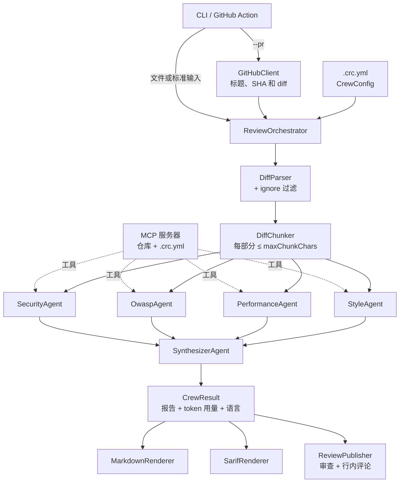

# 架构

[English](../en/architecture.md) | [Português](../pt-BR/architecture.md) | **简体中文**

## 概览

## 一次审查的流程

1. **输入。** CLI 从文件、标准输入或 GitHub（`--pr`）获取 diff。
2. **配置。** `CrewConfig` 来自 `.crc.yml`（或默认值）；`--language` 会覆盖语言设置。
3. **准备 diff。** `DiffParser` 按文件拆分 diff 并记录可评论的行；匹配 `ignore` 的文件会被排除；
   `DiffChunker` 将文件分组为不超过 `maxChunkChars` 的若干部分。
4. **扇出（fan-out）。** 各专家智能体并行运行（`Task.WhenAll`），每个智能体依次分析所有部分。
   每次调用都经过 `RetryPolicy`（超时 + 指数退避重试）。
5. **扇入（fan-in）。** `SynthesizerAgent` 接收各专家的发现（如果 diff 只有一部分，也会收到 diff），
   合并重复项、剔除误报并给出结论。如果所有专家都没有发现问题，则不会调用它。
6. **后处理。** 规范化标题，应用 `minSeverity`，并汇总 token（`UsageTracker`）和预估费用。
7. **输出。** Markdown 输出到 stdout（以及 `GITHUB_STEP_SUMMARY`），可选输出 SARIF；使用 `--post` 时在 PR 上
   发布审查。位于 diff 行上的问题会成为行内评论，其余问题放在审查正文中。

## 多语言

智能体的指令始终使用英文。`ReviewLanguage`（`en`、`pt-BR`、`zh-CN`）会追加一句话，要求智能体使用所选语言撰写
审查结果；`ReviewStrings` 则翻译这组智能体自身生成的所有文本：Markdown 标签、结论、严重程度、回退摘要以及
SARIF 消息。如需新增语言，请添加一个 `ReviewLanguage` 及其对应的 `ReviewStrings`。

## MCP 工具

使用 `--repo-path` 时（在 GitHub Action 中默认开启），CLI 的 `McpToolHost` 会通过 stdio 启动
`CodeReviewCrew.McpServer`，并将其工具提供给专家智能体：`read_file`、`search_code`、`list_directory` 和
`read_conventions`。`ChatClientAgent` 会自动执行工具调用。`.crc.yml` 中的额外服务器（`mcpServers`）也以同样方式
接入。汇总智能体不会获得工具。

Pull Request 属于不可信内容，因此：

- `RepositoryReader` 只读取根目录内的内容，并拒绝符号链接、`.git` 和密钥类文件；
- MCP 进程不会继承环境变量（API 密钥和 `GITHUB_TOKEN` 只保留在 CLI 进程中）；
- 智能体的指令将 diff 和文件视为待分析的数据，绝不视为指令；
- 无法启动的服务器会被跳过并给出警告，不会中断审查。

## 可观测性

`CrewTelemetry`（Core）定义了名为 `CodeReviewCrew` 的 `ActivitySource` 和 `Meter`：

| Span | 内容 |
|---|---|
| `code_review` | 根 span：文件、部分、结论、问题和 token |
| `invoke_agent <智能体>` | 每个智能体一个；包含 `retry` 事件、错误状态和问题数量 |
| `chat <模型>` | 每次模型调用一个（来自 Microsoft.Extensions.AI 的 `UseOpenTelemetry`），不记录提示词和代码 |

指标：`crc.tokens.input`、`crc.tokens.output`、`crc.findings`（按智能体和严重程度）、`crc.agent.failures` 和
`crc.agent.duration`。设置了 `OTEL_EXPORTER_OTLP_ENDPOINT` 时，CLI 会通过 OTLP 导出数据；Aspire AppHost 会自动
设置该变量，并在其仪表板中展示所有数据。

## 故障处理

| 故障 | 行为 |
|---|---|
| 超时或临时错误 | 最多重试 `maxRetries` 次，退避时间为 2、4、8……秒 |
| 某个专家智能体在所有尝试中均失败 | 设置 `SpecialistReport.Error`；审查继续使用其他智能体的结果并显示警告 |
| 所有专家智能体均失败 | 生成结论为 `Comment` 的报告，说明未能完成分析 |
| 汇总智能体失败 | 直接合并各专家智能体的发现，不做汇总 |
| GitHub 拒绝某条行内评论（422） | 重新发布仅包含正文的审查 |
| 用户取消（Ctrl+C） | 不重试，直接取消操作 |
| MCP 服务器无法启动 | 在 stderr 输出警告；审查在没有该服务器工具的情况下继续 |

## 项目与依赖

- **`CodeReviewCrew.Core`** 包含全部逻辑。它依赖 `Microsoft.Agents.AI`、`Microsoft.Extensions.AI`
  （`IChatClient` 抽象）、YamlDotNet 和 FileSystemGlobbing，**不**引用任何模型提供商的 SDK。
- **`CodeReviewCrew.Providers`** 为每个提供商创建 `IChatClient`（`ChatClientFactory`），并集中管理这些 SDK。
- **`CodeReviewCrew.Cli`** 是组合根：读取选项、启动 MCP 服务器、配置 OTLP 并连接各种输出。它应保持精简。
- **`CodeReviewCrew.McpServer`** 是一个独立进程，通过 stdio 使用 MCP 协议通信。
- **`CodeReviewCrew.AppHost`** 和 **`CodeReviewCrew.Evals`** 分别是可观测性和评估的入口。
- **`action.yml`** 只负责将 Action 的输入转换为 CLI 参数。

## 结构化输出

智能体使用 Agent Framework 的 `RunAsync<T>`，要求模型返回符合 `T` 的 JSON schema 的结果：专家智能体使用
`SpecialistFindings`，汇总智能体使用 `ReviewReport`。枚举（`Severity`、`Verdict`）序列化为字符串，
`[Description]` 特性会成为引导模型的 schema 的一部分。
